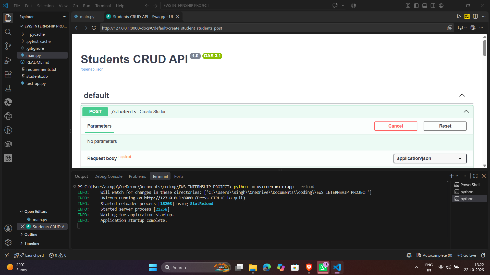
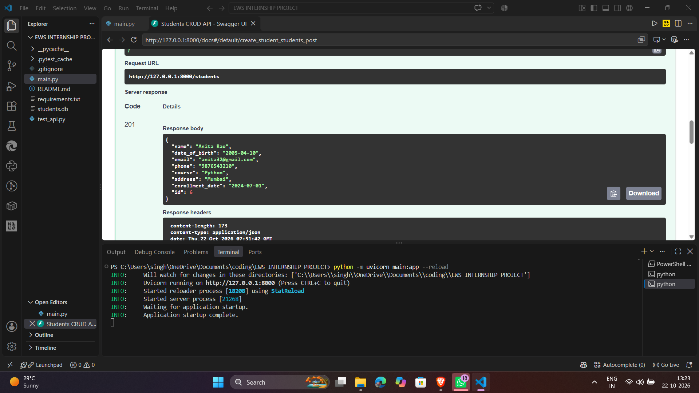

# Students Database CRUD API

A Python backend to manage student records (Create, Read, Update, Delete) built with **FastAPI** and **SQLite**,
plus an optional **Ollama** endpoint that answers natural-language questions about the data.

## Prerequisites
- Python 3.10+
- (Optional bonus only) [Ollama](https://ollama.com) with a small model: `ollama pull llama3.2:1b`

## Installation
```bash
python -m venv .venv
source .venv/bin/activate        # Windows: .venv\Scripts\activate
pip install -r requirements.txt
```

## Run
```bash
uvicorn main:app --reload
```
- API: http://127.0.0.1:8000
- Interactive docs (Swagger UI, try every endpoint here): http://127.0.0.1:8000/docs

The SQLite file `students.db` is created automatically. On the first run, 5 **dummy** students are added
(set `SEED=0` to disable).

## Student fields
| Field | Required | Notes |
|---|---|---|
| `id` | auto | unique, generated by the database |
| `name` | yes | 1-100 characters |
| `date_of_birth` | yes | `YYYY-MM-DD`, must be in the past |
| `email` / `phone` | at least one | email format checked; phone 7-15 digits, optional `+`; email must be unique |
| `course`, `address`, `enrollment_date` | no | |

## Endpoints
| Method | Endpoint | Purpose | Success |
|---|---|---|---|
| POST | `/students` | Create a student | 201 |
| GET | `/students` | List / filter students | 200 |
| GET | `/students/{id}` | View one student | 200 |
| PUT | `/students/{id}` | Replace all details | 200 |
| PATCH | `/students/{id}` | Update only the fields sent | 200 |
| DELETE | `/students/{id}` | Delete a student | 204 |
| POST | `/ask` | (Bonus) ask a question using local AI | 200 |

Errors: `404` student not found, `409` duplicate email, `422` invalid input.
Filters for `GET /students`: `name` (partial), `course`, `born_after`, `born_before`, `limit`, `offset`.

## Sample requests (curl)
```bash
# Create
curl -X POST http://127.0.0.1:8000/students -H "Content-Type: application/json" \
  -d '{"name":"Anita Rao","date_of_birth":"2005-04-10","email":"anita@example.com","course":"Python"}'

# List all / filter
curl http://127.0.0.1:8000/students
curl "http://127.0.0.1:8000/students?course=python&born_after=2004-12-31"

# View one
curl http://127.0.0.1:8000/students/1

# Update (partial)
curl -X PATCH http://127.0.0.1:8000/students/1 -H "Content-Type: application/json" -d '{"course":"AI"}'

# Delete
curl -X DELETE http://127.0.0.1:8000/students/1
```

## Automated tests
```bash
pytest -q
```
Covers all four CRUD operations, validation, 404/409/422 handling, filters, SQL-injection safety, and the AI endpoint
(with the model mocked). Tests use a temporary database, so your data is never touched.

## Optional bonus: local AI with Ollama
```bash
ollama pull llama3.2:1b
ollama serve                      # if not already running
curl -X POST http://127.0.0.1:8000/ask -H "Content-Type: application/json" \
  -d '{"question":"List students born after 2005"}'
```
How it stays safe and accurate:
1. The **backend** understands simple patterns ("born after/before/in YYYY", course names) and fetches matching rows
   with fixed, **parameterised SQL**. The model never writes or runs SQL.
2. The matching count and records are placed in the prompt, and the model is told to answer **only** from them.
3. The response includes `records_used`, so you can verify the answer against the real data.

If Ollama isn't running, `/ask` returns a clear `503` message. Settings can be changed with the environment variables
`OLLAMA_URL` and `OLLAMA_MODEL`.

## Project structure
```
main.py            the whole app: database, validation, CRUD routes, /ask
test_api.py        automated tests
requirements.txt   dependencies
```

## Notes
- All data is dummy data. Do not commit real student information. `students.db` is git-ignored.
- SQL always uses `?` placeholders (never string-built values), which prevents SQL injection.

## Screenshots

### API documentation (Swagger UI at `/docs`)


### Creating a student (POST /students)
